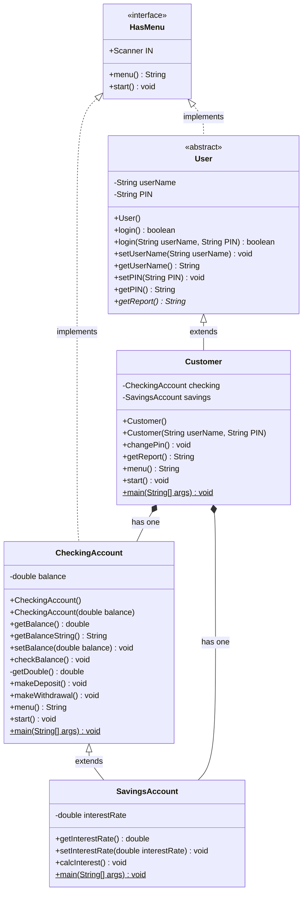

# Bank Project (Part 1)

A bank program in Java. That allows you to do the basic functions of what a bank does.

## How to run

```
make testCustomer
```

Test login: user name `Alice`, PIN `0000`.

## UML Class Diagram



## Algorithm

### Customer main

```
create a Customer (Alice, PIN 0000)
if login() succeeds
    start the customer menu
else
    end the program
```

### login()

```
ask for user name
ask for PIN
if user name and PIN both match the customer's
    print "Login Successful"
    return true
else
    print "Login Failed"
    return false
```

### Customer start()

```
keepGoing = true
while keepGoing
    show the customer menu and read response
    if response is 0
        keepGoing = false
    else if response is 1
        run the checking account menu
    else if response is 2
        run the savings account menu
    else if response is 3
        change the PIN
    else
        print an error message
```

### Account start() (checking and savings)

```
keepGoing = true
while keepGoing
    show the account menu and read response
    if response is 0
        keepGoing = false
    else if response is 1
        print the current balance
    else if response is 2
        read an amount
        add it to the balance
        print the new balance
    else if response is 3
        read an amount
        subtract it from the balance
        print the new balance
    else
        print an error message
```

### getDouble()

```
try to convert the user's input to a double
if the input is not a number
    print an error message
    return 0
else
    return the number
```

